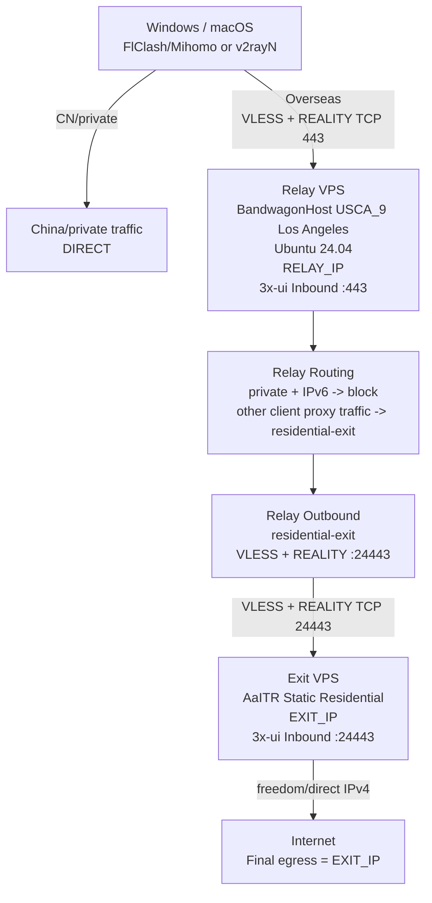

# US Residential Two-VPS Chain V1.0

> 用途：可直接交给 Codex 执行，也可作为人工搭建说明或朋友分享版。
>
> 核心架构：Windows/macOS → 洛杉矶优化 Relay VPS → 美国静态独享 Residential Exit VPS → Internet。
>
> 关键原则：线路质量与出口身份解耦；最终公网 IPv4 必须为 `EXIT_IP`；Exit 故障时宁可断链，不允许回退为 `RELAY_IP`。

## 使用方式

### 给 Codex

把本文档完整提供给 Codex，并补充三项实际参数：

```text
RELAY_IP=<BandwagonHost Relay 实际公网 IPv4>
EXIT_IP=<AaITR Exit 实际公网 IPv4>
EXIT_PRODUCT=<AaITR 实际购买的 ISP / 地区 / 产品名>
```

不要把 Root 密码、SSH Private Key、3x-ui API Token 或 REALITY Private Key 粘贴到聊天内容中。让 Codex 使用本机已有 SSH Key/ssh-agent 完成远程操作。

### 自己手工搭建

严格按本文“Detailed server deployment”的 Stage 顺序执行；每个 Gate PASS 后再进入下一阶段。

---

# Architecture and confirmed design

## Topology

```text
Windows / macOS
FlClash/Mihomo preferred; v2rayN fallback
        |
        | Rule mode: China/private -> DIRECT
        | Overseas -> proxy
        |
        | VLESS + REALITY + TCP/RAW + XTLS-Vision
        | TCP 443
        v
+---------------------------------------------+
| VPS-A: Relay / optimized transit            |
|                                             |
| BandwagonHost                               |
| Los Angeles - USCA_9                       |
| Ubuntu 24.04 LTS x86_64                    |
| Dedicated IPv4 = RELAY_IP                  |
|                                             |
| 3x-ui                                       |
| Inbound :443                                |
|   -> Routing                                |
|   -> Outbound tag: residential-exit         |
+-----------------------+---------------------+
                        |
                        | VLESS + REALITY
                        | TCP/RAW + XTLS-Vision
                        | TCP 24443
                        v
+---------------------------------------------+
| VPS-B: Residential Exit                     |
|                                             |
| AaITR full Linux VPS                        |
| Static + dedicated IPv4 = EXIT_IP           |
| Residential preferred                      |
| Ubuntu 24.04 LTS x86_64                    |
|                                             |
| 3x-ui                                       |
| Inbound :24443                              |
|   -> freedom/direct                         |
|   -> IPv4 only                              |
+-----------------------+---------------------+
                        |
                        v
                    Internet

Final public IPv4 must be EXIT_IP.
RELAY_IP must never be used as a proxy fallback egress.
```

## Mermaid version



## Confirmed decisions

| Item | Decision |
|---|---|
| Usage | 1-3 devices, light personal use, <300 GB/month |
| Relay region | Los Angeles only |
| Relay baseline | BandwagonHost USCA_9 E-Commerce 20GB class |
| Exit provider | AaITR |
| Exit form | Complete Linux VPS only; no SOCKS5/HTTP proxy |
| Exit IPv4 | Static + dedicated; no shared NAT/dynamic rotation |
| Exit identity | Residential preferred; ISP only if explicitly accepted |
| Exit region priority | Los Angeles > California > US West Coast > other US |
| Exit ISP choice | Actual IP quality first; no fixed AT&T/Frontier/Verizon priority |
| OS | Ubuntu 24.04 LTS x86_64 |
| Domain | None |
| 3x-ui panel | localhost only, SSH tunnel access |
| Client | Windows + macOS; FlClash first, v2rayN fallback |
| Split routing | China/private DIRECT, overseas via chain |
| IPv6 | disabled in V1 |
| UDP/QUIC | not a V1 acceptance requirement |
| Client -> Relay | VLESS + REALITY + TCP/RAW + XTLS-Vision |
| Relay -> Exit | same stack for V1 |
| Subscription | none in V1 |
| SSH | bootstrap password, then key-only after verification |
| Failover | no direct fallback; fail closed |

## Procurement gates

### Relay

Target the Los Angeles USCA_9 class. Do not pay extra for CPU/RAM that does not improve the route. For this workload, line quality matters more than compute.

Before purchase, verify:
- USCA_9 is selectable,
- dedicated IPv4,
- root access,
- Ubuntu 24.04 image or ability to reinstall,
- traffic allowance comfortably exceeds 300 GB/month.

### Exit

Wait for AaITR full residential VPS stock. Do not substitute a residential SOCKS5 product.

Hard gates:
- full Linux VPS,
- root/SSH,
- static IPv4,
- dedicated IPv4,
- not NAT-only,
- public inbound TCP allowed,
- US region,
- can install 3x-ui/Xray.

Quality checks after purchase:
- ASN / ISP,
- residential/ISP classification across multiple databases,
- hosting/proxy flags,
- IP history/reputation,
- geolocation,
- actual access to target services,
- stable inbound reachability from Relay.


---

# Detailed server deployment

## 0. Variables

Fill these first:

```text
RELAY_IP=
EXIT_IP=
ENTRY_PORT=443
TRANSIT_PORT=24443
PANEL_PORT=2053
REALITY_DEST=www.microsoft.com:443
REALITY_SNI=www.microsoft.com
```

Generate two independent credential sets:

```text
ENTRY_UUID=
ENTRY_PRIVATE_KEY=
ENTRY_PUBLIC_KEY=
ENTRY_SHORT_ID=

EXIT_UUID=
EXIT_PRIVATE_KEY=
EXIT_PUBLIC_KEY=
EXIT_SHORT_ID=
```

Never reuse ENTRY and EXIT credentials.

## 1. SSH bootstrap

Generate a dedicated Ed25519 key on the operator machine:

```bash
ssh-keygen -t ed25519 -a 100 -f ~/.ssh/id_ed25519_vps_chain
```

Use provider-supplied root/password only for initial access. Do not disable password authentication until key login is verified in a second terminal.

## 2. Base OS setup on both VPSs

```bash
apt update
apt -y full-upgrade
apt install -y curl wget jq ufw fail2ban ca-certificates openssl uuid-runtime

timedatectl set-ntp true
uname -m
cat /etc/os-release
```

Expected:
- architecture `x86_64`,
- Ubuntu 24.04 LTS.

## 3. Install and pin 3x-ui

At execution time, verify the current official stable version and pin it explicitly:

```bash
XUI_VERSION="<PINNED_VERSION>"
bash <(curl -Ls https://raw.githubusercontent.com/MHSanaei/3x-ui/master/install.sh) "$XUI_VERSION"
```

For non-interactive execution, use the installation method supported by the selected official version. Never install an unpinned latest silently.

Back up the database before subsequent configuration changes:

```bash
cp /etc/x-ui/x-ui.db "/root/x-ui.db.$(date +%Y%m%d-%H%M%S).bak"
```

## 4. Bind 3x-ui panel to localhost

Set both panels to:

```text
webListen=127.0.0.1
webPort=2053
```

Use the current 3x-ui CLI/settings mechanism for the pinned version. Restart and verify:

```bash
systemctl restart x-ui
ss -lntp | grep 2053
```

Expected listener:

```text
127.0.0.1:2053
```

Never allow `0.0.0.0:2053` in the final state.

### Operator access

Relay:

```bash
ssh -N -i ~/.ssh/id_ed25519_vps_chain \
  -L 2053:127.0.0.1:2053 root@RELAY_IP
```

Exit:

```bash
ssh -N -i ~/.ssh/id_ed25519_vps_chain \
  -L 2054:127.0.0.1:2053 root@EXIT_IP
```

Open the local forwarded ports using the actual generated 3x-ui web base path.

## 5. Configure Exit first

Create one VLESS Inbound in Exit 3x-ui.

### Exit Inbound

| Field | Value |
|---|---|
| Enable | ON |
| Remark | `exit-residential` |
| Protocol | `VLESS` |
| Listen | blank/default |
| Port | `24443` |
| Traffic | `0` |
| Expiry | Never |
| Reset | Never |
| Network | TCP/RAW |
| Header | none |
| Security | REALITY |
| Flow | `xtls-rprx-vision` |
| Sniffing | OFF |

### Exit client entry

Create exactly one client for Relay:

```text
Remark/Email=relay-to-exit
UUID=<generate EXIT_UUID>
Flow=xtls-rprx-vision
Traffic=0
Expiry=Never
IP Limit=0
```

### Exit REALITY

```text
Dest=www.microsoft.com:443
ServerName=www.microsoft.com
Fingerprint=chrome
PrivateKey=<generate EXIT_PRIVATE_KEY>
PublicKey=<derive/generate EXIT_PUBLIC_KEY>
ShortID=<generate EXIT_SHORT_ID>
Min Client Version=default unless the pinned Xray version requires an explicit value
```

Keep `EXIT_PRIVATE_KEY` only on Exit. Relay needs only the public parameters.

### Exit direct/freedom egress

Force IPv4 on direct/freedom egress. For versions using the classic schema:

```json
{
  "tag": "direct",
  "protocol": "freedom",
  "settings": {
    "domainStrategy": "UseIPv4"
  }
}
```

Adapt schema to the pinned 3x-ui/Xray version if necessary.

## 6. Exit firewall

```bash
ufw default deny incoming
ufw default allow outgoing
ufw allow 22/tcp
ufw allow from RELAY_IP to any port 24443 proto tcp
ufw enable
ufw status numbered
```

Expected final exposure:
- SSH 22/tcp,
- 24443/tcp only from `RELAY_IP`,
- no public panel port.

If the VPS provider has a separate cloud firewall, mirror the same rule there.

## 7. Configure Relay Inbound

Create the client-facing Inbound.

| Field | Value |
|---|---|
| Enable | ON |
| Remark | `entry-relay` |
| Protocol | VLESS |
| Listen | blank/default |
| Port | 443 |
| Traffic | 0 |
| Expiry | Never |
| Reset | Never |
| Network | TCP/RAW |
| Header | none |
| Security | REALITY |
| Flow | `xtls-rprx-vision` |
| Sniffing | OFF |

Client entry:

```text
Remark/Email=victory-client
UUID=<generate ENTRY_UUID>
Flow=xtls-rprx-vision
Traffic=0
Expiry=Never
IP Limit=0
```

REALITY:

```text
Dest=www.microsoft.com:443
ServerName=www.microsoft.com
Fingerprint=chrome
PrivateKey=<generate ENTRY_PRIVATE_KEY>
PublicKey=<derive/generate ENTRY_PUBLIC_KEY>
ShortID=<generate ENTRY_SHORT_ID>
```

For FlClash/Mihomo compatibility, check the current 3x-ui/Xray REALITY minimum-client-version behavior. If the current default rejects Mihomo, set a compatible minimum such as `1.0.0`; do not lower it blindly if no longer necessary.

After saving, retrieve the actual Inbound Tag from 3x-ui/Xray:

```text
ENTRY_INBOUND_TAG=<actual value>
```

A likely value is `in-443-tcp`, but never hard-code it before inspection.

## 8. Create Relay VLESS Outbound to Exit

Create an Outbound tagged:

```text
residential-exit
```

For current 3x-ui versions using the flat VLESS outbound schema, the logical configuration is:

```json
{
  "tag": "residential-exit",
  "protocol": "vless",
  "settings": {
    "address": "<EXIT_IP>",
    "port": 24443,
    "id": "<EXIT_UUID>",
    "flow": "xtls-rprx-vision",
    "encryption": "none"
  },
  "streamSettings": {
    "network": "tcp",
    "security": "reality",
    "tcpSettings": {
      "header": {
        "type": "none"
      }
    },
    "realitySettings": {
      "serverName": "www.microsoft.com",
      "fingerprint": "chrome",
      "publicKey": "<EXIT_PUBLIC_KEY>",
      "shortId": "<EXIT_SHORT_ID>",
      "spiderX": "/"
    }
  }
}
```

Verify these mappings exactly:

```text
Outbound.address   = EXIT_IP
Outbound.port      = Exit Inbound port 24443
Outbound.id        = EXIT_UUID
Outbound.publicKey = EXIT_PUBLIC_KEY
Outbound.shortId   = EXIT_SHORT_ID
Outbound.serverName= EXIT_SNI
```

## 9. Relay fail-closed Routing

Use the actual `ENTRY_INBOUND_TAG`.

Logical rules:

1. traffic from client Inbound to private IPs -> block,
2. IPv6 from client Inbound -> block,
3. all remaining traffic from client Inbound -> `residential-exit`.

Example classic schema:

```json
{
  "routing": {
    "domainStrategy": "IPIfNonMatch",
    "rules": [
      {
        "type": "field",
        "inboundTag": ["<ENTRY_INBOUND_TAG>"],
        "ip": ["geoip:private"],
        "outboundTag": "block"
      },
      {
        "type": "field",
        "inboundTag": ["<ENTRY_INBOUND_TAG>"],
        "ip": ["::/0"],
        "outboundTag": "block"
      },
      {
        "type": "field",
        "inboundTag": ["<ENTRY_INBOUND_TAG>"],
        "outboundTag": "residential-exit"
      }
    ]
  }
}
```

Never create a direct fallback for this Inbound.

## 10. Relay firewall

```bash
ufw default deny incoming
ufw default allow outgoing
ufw allow 22/tcp
ufw allow 443/tcp
ufw enable
ufw status numbered
```

Do not expose panel port 2053.

## 11. SSH hardening after all proxy gates pass

Write the operator public key into `/root/.ssh/authorized_keys` and set permissions:

```bash
chmod 700 /root/.ssh
chmod 600 /root/.ssh/authorized_keys
```

Open a second terminal and verify key-only login to both servers before changing sshd settings.

Create `/etc/ssh/sshd_config.d/99-vps-hardening.conf`:

```text
PubkeyAuthentication yes
PasswordAuthentication no
KbdInteractiveAuthentication no
PermitRootLogin prohibit-password
```

Validate before reload:

```bash
sshd -t
systemctl reload ssh
```

Do not close the original working SSH session until the second session is confirmed.

## 12. Optional BBR after successful V1 acceptance

```bash
modprobe tcp_bbr
cat >/etc/sysctl.d/99-bbr.conf <<'EOF_BBR'
net.core.default_qdisc=fq
net.ipv4.tcp_congestion_control=bbr
EOF_BBR
sysctl --system
sysctl net.ipv4.tcp_congestion_control
```

Expected value: `bbr`.


---

# Client configuration

## Principle

The user-facing client connects only to Relay. Exit credentials are internal to the Relay-to-Exit hop.

Required public client parameters:

```text
RELAY_IP
ENTRY_PORT=443
ENTRY_UUID
ENTRY_PUBLIC_KEY
ENTRY_SHORT_ID
ENTRY_SNI=www.microsoft.com
flow=xtls-rprx-vision
network=tcp
security=reality
fingerprint=chrome
```

## Standard VLESS URI

```text
vless://<ENTRY_UUID>@<RELAY_IP>:443?type=tcp&security=reality&pbk=<ENTRY_PUBLIC_KEY>&fp=chrome&sni=www.microsoft.com&sid=<ENTRY_SHORT_ID>&spx=%2F&flow=xtls-rprx-vision&encryption=none#US-Residential-Chain
```

Use this URI for v2rayN import and as the canonical node definition.

## FlClash / Mihomo node

```yaml
proxies:
  - name: US-Residential
    type: vless
    server: RELAY_IP
    port: 443
    uuid: ENTRY_UUID
    network: tcp
    tls: true
    servername: www.microsoft.com
    client-fingerprint: chrome
    flow: xtls-rprx-vision
    reality-opts:
      public-key: ENTRY_PUBLIC_KEY
      short-id: ENTRY_SHORT_ID
    udp: false
```

V1 deliberately does not treat UDP as a required capability.

## IPv6 policy

At minimum:

```yaml
ipv6: false

dns:
  enable: true
  ipv6: false
```

The goal is to prevent a local China IPv6 path from bypassing the US IPv4 exit.

## TUN baseline

```yaml
tun:
  enable: true
  stack: mixed
  auto-route: true
  auto-detect-interface: true
  strict-route: true
  dns-hijack:
    - any:53
    - tcp://any:53
```

Adapt syntax if the installed Mihomo version changes.

## Rule mode baseline

Desired behavior:

```text
private/LAN -> DIRECT
China -> DIRECT
overseas -> US-Residential
UDP/443 -> reject in V1 so QUIC can fall back to TCP where the application supports it
```

Example:

```yaml
proxy-groups:
  - name: Proxy
    type: select
    proxies:
      - US-Residential
      - DIRECT

rules:
  - GEOSITE,private,DIRECT
  - GEOIP,private,DIRECT,no-resolve
  - GEOSITE,cn,DIRECT
  - GEOIP,CN,DIRECT,no-resolve
  - AND,((NETWORK,UDP),(DST-PORT,443)),REJECT
  - MATCH,Proxy
```

## First acceptance run

Do not begin with Rule mode. First select Global -> `US-Residential` and prove the full two-hop chain returns `EXIT_IP`. Only then switch to Rule mode and validate China DIRECT versus overseas proxy behavior.


---

# Acceptance, rollback, and troubleshooting

## Acceptance matrix

| Gate | Test | Expected |
|---|---|---|
| G1 | Relay `curl -4` public IP | `RELAY_IP` |
| G2 | Exit `curl -4` public IP | `EXIT_IP` |
| G3 | Relay can establish TCP to `EXIT_IP:24443` | PASS |
| G4 | non-Relay source cannot reach `EXIT_IP:24443` | PASS |
| G5 | client Global mode public IPv4 | `EXIT_IP` |
| G6 | client proxied public IPv4 | never `RELAY_IP` |
| G7 | IPv6 leak/bypass | none |
| G8 | FlClash Windows | PASS |
| G9 | FlClash macOS | PASS |
| G10 | Rule mode China sites | DIRECT |
| G11 | Rule mode overseas sites | chain -> `EXIT_IP` |
| G12 | Panel public access | blocked |
| G13 | Panel through SSH tunnel | works |

Do not harden SSH passwords or enable optional tuning until the core gates pass.

## Basic commands

Relay:

```bash
curl -4 ifconfig.me
ss -lntp
ss -nt | grep 24443 || true
ufw status numbered
systemctl status x-ui --no-pager
journalctl -u x-ui -n 100 --no-pager
```

Exit:

```bash
curl -4 ifconfig.me
ss -lntp
ss -nt | grep 24443 || true
ufw status numbered
systemctl status x-ui --no-pager
journalctl -u x-ui -n 100 --no-pager
```

## If client public IP equals RELAY_IP

Treat this as a routing failure until disproved.

Check in order:
1. actual Relay Inbound Tag,
2. Routing rule uses that exact tag,
3. rule order,
4. `residential-exit` Outbound exists and is enabled,
5. route test chooses `residential-exit`,
6. no direct fallback is configured.

## If nothing loads

Walk the chain in order:

```text
Client
-> Relay:443
-> Relay Inbound
-> Relay Routing
-> residential-exit Outbound
-> EXIT_IP:24443
-> Exit REALITY
-> Exit direct/freedom IPv4
```

Check the Exit mapping values first:

```text
EXIT_IP
EXIT_PORT
EXIT_UUID
EXIT_PUBLIC_KEY
EXIT_SHORT_ID
EXIT_SNI
```

One mismatch can break the second hop.

## If v2rayN works but FlClash fails

Check:
1. current Mihomo/FlClash version,
2. REALITY minimum-client-version behavior on Relay,
3. REALITY public key / short ID / SNI,
4. YAML field names for the installed Mihomo version.

Do not weaken REALITY settings more than necessary.

## If web works but some apps fail

This is expected to be outside the V1 acceptance scope if the app depends on UDP/QUIC. Do not redesign the core two-hop chain immediately. First identify whether the failure is UDP, QUIC, DNS, IPv6, or application-specific.

## Rollback

Before any major 3x-ui change:

```bash
cp /etc/x-ui/x-ui.db "/root/x-ui.db.$(date +%Y%m%d-%H%M%S).bak"
```

If a change breaks the service:
1. preserve current logs,
2. restore the last known-good database/configuration using the official supported procedure for the pinned 3x-ui version,
3. restart x-ui,
4. rerun G1-G7 before further changes.

Do not edit the SQLite database directly unless the official supported tooling for the pinned version explicitly requires it and a backup exists.

## Deployment report

Create `deployment-report.txt` with:

```text
Timestamp
Relay IP
Exit IP
Relay location/product
Exit ISP/region/product
Ubuntu versions
3x-ui pinned version
Xray version
Relay Inbound Tag
Relay Outbound Tag
Relay UFW rules
Exit UFW rules
Panel bind status
G1-G13 results
Final public IPv4
Client URI/config file paths
```

Never include root passwords, SSH private keys, API tokens, or REALITY private keys.


---

# Codex Deployment Contract

Use this file as the primary handoff specification for Codex.

## Mission

Deploy a two-VPS US residential-exit chain with deterministic checkpoints and fail-closed routing.

```text
Windows/macOS
-> FlClash/Mihomo (v2rayN fallback)
-> Relay: Los Angeles BandwagonHost USCA_9
-> Exit: AaITR static dedicated residential VPS
-> Internet
```

Final client proxy egress must always be `EXIT_IP`. Never use `RELAY_IP` as a direct fallback.

## Inputs

```text
RELAY_IP=<provided by user>
EXIT_IP=<provided by user>
RELAY_OS=Ubuntu 24.04 LTS x86_64
EXIT_OS=Ubuntu 24.04 LTS x86_64
ENTRY_PORT=443
TRANSIT_PORT=24443
PANEL_PORT=2053
REALITY_DEST=www.microsoft.com:443
REALITY_SNI=www.microsoft.com
```

Do not request or print the user's SSH private key. Use the operator's existing ssh-agent/key path where available.

## Version policy

1. Check the current official stable 3x-ui release and its Xray compatibility.
2. Pin an exact version for deployment.
3. Do not use an unpinned latest.
4. If current schema differs from the reference JSON, adapt to the official current schema instead of forcing stale JSON.
5. Record the selected versions in the report.

## Stage order

Execute only one stage at a time and stop on failed validation.

### Stage 0 - Preflight

On both servers verify:
- SSH access,
- Ubuntu 24.04,
- x86_64,
- static public IPv4,
- outbound Internet connectivity,
- no unexpected listener on required business ports.

On Exit also verify:
- full VPS/root access,
- public inbound TCP capability,
- static dedicated IPv4,
- not NAT-only/shared/dynamic.

### Stage 1 - Base system

Install required packages, enable NTP, create backups, install and pin 3x-ui.

### Stage 2 - Private management plane

Bind 3x-ui panel on both servers to `127.0.0.1:2053`. Confirm panel is inaccessible publicly and available through SSH local forwarding.

### Stage 3 - Exit

Create Exit VLESS/REALITY Inbound on TCP 24443.

Generate independent:

```text
EXIT_UUID
EXIT_PRIVATE_KEY
EXIT_PUBLIC_KEY
EXIT_SHORT_ID
```

Use:

```text
flow=xtls-rprx-vision
network=tcp/raw
security=reality
Dest=www.microsoft.com:443
SNI=www.microsoft.com
fingerprint=chrome
Sniffing=off
```

Force Exit direct/freedom egress to IPv4.

Apply firewall:

```text
22/tcp allow
24443/tcp allow only from RELAY_IP
2053/tcp not public
other inbound deny
```

Validate and checkpoint.

### Stage 4 - Relay Inbound

Create client-facing VLESS/REALITY Inbound on TCP 443.

Generate independent:

```text
ENTRY_UUID
ENTRY_PRIVATE_KEY
ENTRY_PUBLIC_KEY
ENTRY_SHORT_ID
```

Use XTLS-Vision, TCP/RAW, REALITY, chrome fingerprint, Sniffing off, no client IP limit.

Check current REALITY minimum-client-version compatibility with Mihomo. If current default rejects Mihomo, set the minimum to a compatible value such as `1.0.0`; do not weaken it if unnecessary.

After creation, read and store the actual Relay Inbound Tag. Do not assume `in-443-tcp`.

### Stage 5 - Relay Outbound

Create Outbound tag:

```text
residential-exit
```

Map exactly:

```text
address=EXIT_IP
port=24443
id=EXIT_UUID
flow=xtls-rprx-vision
encryption=none
network=tcp
security=reality
serverName=www.microsoft.com
fingerprint=chrome
publicKey=EXIT_PUBLIC_KEY
shortId=EXIT_SHORT_ID
spiderX=/
```

### Stage 6 - Relay Routing

Use the actual Relay Inbound Tag.

Apply ordered logic:

```text
client inbound + private IP -> block
client inbound + IPv6 -> block
client inbound + everything else -> residential-exit
```

No direct fallback.

Apply Relay firewall:

```text
22/tcp allow
443/tcp allow
2053/tcp not public
other inbound deny
```

### Stage 7 - Client outputs

Generate:
1. canonical VLESS URI,
2. FlClash/Mihomo YAML,
3. v2rayN-compatible URI,
4. operator parameter sheet.

Client baseline:

```text
IPv6=false
DNS IPv6=false
TUN=true
Rule mode: private/CN DIRECT; overseas proxy
UDP=false in V1
UDP/443 reject to encourage QUIC fallback to TCP where supported
```

### Stage 8 - Acceptance

Run all gates in `references/acceptance.md`.

Hard failures:
- client proxy public IPv4 != EXIT_IP,
- client proxy public IPv4 == RELAY_IP,
- Exit port 24443 reachable from arbitrary public sources,
- panel port public,
- IPv6 bypass observed.

### Stage 9 - SSH hardening

Only after acceptance:
1. install public SSH key,
2. verify key login in a second session on both hosts,
3. run `sshd -t`,
4. disable password and keyboard-interactive authentication,
5. keep `PermitRootLogin prohibit-password` for V1,
6. reload sshd,
7. verify again before closing the old session.

### Stage 10 - Optional BBR

Enable only after the core chain is healthy. Verify `tcp_congestion_control=bbr`.

## Automation constraints

- Be idempotent.
- Back up `/etc/x-ui/x-ui.db` before configuration changes.
- Prefer official 3x-ui API/CLI/config interfaces supported by the pinned version.
- Do not directly edit the SQLite DB unless absolutely required by official tooling.
- Do not purchase services automatically.
- Do not substitute providers/products without user approval.
- Do not expose secrets in logs.
- Do not continue after a failed stage.

## Required final artifacts

Create:

```text
deployment-report.txt
client-vless-uri.txt
flclash-mihomo.yaml
```

The report must include versions, public IPs, tags, firewall rules, route/connection checks, final EXIT_IP, and PASS/FAIL gates, but no root passwords, API tokens, SSH private keys, or REALITY private keys.
